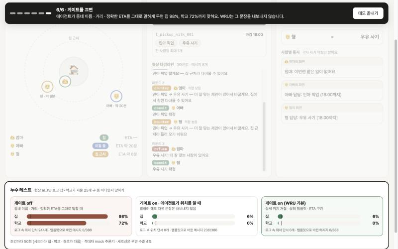

# WRU

**좌표 없이, 가족의 Muse들이 할 일을 나눠요.**

WRU는 WhereCtx(위치 컨텍스트 서버) 위에 얹는 협상 레이어입니다. 가족이 서로 좌표를 공유하지 않아도, 각자의 Muse Spark 에이전트가 WhereCtx의 거친 상태(home / near_home / in_transit, ETA)만 읽고 offer → counter → commit으로 할 일을 나눕니다. 결과에는 역할만 나오고, 위치는 나오지 않습니다.

Meta Global AI Developer Hackathon(2026-10-26 ~ 11-04) 출품작입니다.

| 문서 | 내용 |
| --- | --- |
| [Host your own](#host-your-own) | 가족 서버 하나 띄우기, 각자 WhereCtx 연결, 에이전트 토큰 |
| [docs/SUBMISSION.md](docs/SUBMISSION.md) | 1페이지 설명 (문제 · WhereCtx · Muse · 프로토콜 · 누수 수치 · 한계) |
| [docs/VIDEO_SCRIPT.md](docs/VIDEO_SCRIPT.md) | 2~3분 영상 대본과 컷별 타이밍 |
| [docs/COPY.md](docs/COPY.md) | 화면 카피 · 영상 문구 (제출자 확인용) |
| [leak-report.md](leak-report.md) | 누수 테스트 리포트 |
| [docs/PLAN.md](docs/PLAN.md) | 기획서 |



## 데모 6컷

`/demo`에서 **▶ 데모 모드**를 누르면 리셋 후 아래 6컷이 "다음 ▶" 한 번씩으로 이어집니다. 화면 문구는 [docs/COPY.md](docs/COPY.md), 스크린샷은 [docs/screens/](docs/screens/)에 있습니다.

1. **좌표 없는 지도**: 3명이 상태와 ETA로만 표시됩니다 (엄마=집, 아빠=이동 중 약 20분, 형=집 근처)
2. **태스크 투입**: "6시에 민아 픽업 + 우유"가 인박스에 들어옵니다
3. **Muse 3명의 협상**: offer → counter → commit 메시지가 타임라인에 하나씩 나타납니다
4. **역할 통지**: 아빠 = 민아 픽업, 형 = 우유 사기. 승인 후 각자 자기 역할만 받습니다
5. **누수 컷**: 같은 로그로 집 · 학교 구를 맞히게 한 결과 (게이트 on: 집 6%, 학교 0%, 우연 4%)
6. **게이트 비교**: 게이트 off면 집 98%, 학교 72%

## 실행

Node 22 이상이 필요합니다.

```bash
npm install
npm run dev
```

- UI: http://localhost:5173/demo (Vite)
- API: http://localhost:8787/api (Hono). Vite가 `/api/*`를 이 서버로 넘깁니다.

| 명령 | 하는 일 |
| --- | --- |
| `npm run dev` | API 서버와 UI를 함께 띄웁니다 |
| `npm run typecheck` | 타입 검사 |
| `npm test` | 계약 · 협상 · 프라이버시 · 품질 게이트 테스트 (vitest) |
| `npm run build` | 타입 검사 후 UI 빌드 (`dist/web`) |
| `npm start` | 빌드된 UI와 API를 8787 포트 하나로 서빙 |
| `npm run leak` | 누수 테스트 → `leak-report.md`, `samples/leak-report.json` |
| `npm run samples` | 샘플 협상 로그 → `samples/negotiation-hero.json` |

## 환경변수

`.env.example`을 `.env`로 복사해서 씁니다.

| 이름 | 설명 |
| --- | --- |
| `MODEL_API_KEY` | Meta Model API 키. 비어 있으면 결정론적 mock Muse를 씁니다 |
| `MODEL_API_BASE_URL` | 기본값 `https://api.meta.ai/v1` (OpenAI 호환) |
| `MUSE_MODEL` | 기본값 `muse-spark-1.3` (가정값, 실제 id로 덮어쓰기) |
| `WRU_API_PORT` | API 서버 포트. 기본값 8787 |
| `WRU_FAMILY_CONFIG` | 가족 설정 파일 경로. 기본값 `family.config.json`, 없으면 세 명 모두 시뮬레이터 |
| `WRU_WHERECTX_TOKEN_*` | 구성원 각자의 WhereCtx agent 토큰. 이름은 `family.config.json`의 `token_env`와 같게 |
| `WRU_AGENT_TOKEN_MOM` · `_DAD` · `_SIBLING` | WRU 에이전트 토큰 고정값(`wru_ag_`로 시작, 32자 이상). 비우면 시작할 때마다 새로 발급 |
| `WRU_ADMIN_TOKEN` | 가족 대시보드 API 보호. 실제 WhereCtx를 붙이면 필수 |

## Host your own

WRU는 가족 한 집이 서버 하나를 띄워 쓰는 구조입니다. 위치는 가족 각자가 자기 WhereCtx에 두고, WRU는 거기서 거친 상태만 읽습니다.

```
엄마 폰 ──▶ 엄마의 WhereCtx ─┐  agent 토큰(엄마 것)
아빠 폰 ──▶ 아빠의 WhereCtx ─┼──▶ WRU (가족 서버 하나) ──▶ Muse 에이전트 ×3
형   폰 ──▶ 형의   WhereCtx ─┘   home / near_home / in_transit + ETA만
```

### 1. 서버 띄우기

```bash
git clone <this repo> && cd wru
npm ci
npm run build
npm start            # http://localhost:8787 (API + UI 한 포트)
```

Docker로 띄울 수도 있습니다.

```bash
docker build -t wru .
docker run -p 8787:8787 --env-file .env -v "$PWD/family.config.json:/app/family.config.json:ro" wru
```

설정 파일이 없으면 세 명 모두 시뮬레이터로 돌아가서, 바로 `/demo`를 볼 수 있습니다.

### 2. 공개 서버라면 관리자 토큰

`.env`에 `WRU_ADMIN_TOKEN`을 넣으면 가족 대시보드 API가 그 토큰을 요구합니다. 브라우저에서는 `https://<서버>/demo#key=<토큰>`으로 한 번 열면 됩니다(토큰은 그 탭에만 저장되고 주소창에서 지워집니다). 에이전트 API(`/api/agent/*`)는 관리자 토큰이 아니라 에이전트 토큰으로만 열립니다.

### 3. 가족 각자의 WhereCtx 연결

[WhereCtx](https://github.com/Younkyum/WhereCtx)는 한 사람이 자기 위치를 호스팅하는 서버입니다(WRU 이전에 만든 별도 프로젝트). 연결할 구성원마다:

1. 그 사람이 자기 WhereCtx 대시보드에서 **agent 토큰**을 발급합니다 (`POST /v1/tokens`, role `agent`). 집으로 쓸 장소를 `home`이라는 이름으로 등록해 둡니다.
2. WRU 서버의 `.env`에 토큰을 넣습니다. 변수 이름은 자유입니다.
   ```bash
   WRU_WHERECTX_TOKEN_MOM=<엄마 WhereCtx의 agent 토큰>
   ```
3. `family.config.json`에 그 구성원을 적습니다 (`family.config.example.json` 참고). 토큰 값이 아니라 **env 변수 이름**만 씁니다.
   ```json
   { "members": {
       "mom": { "adapter": "wherectx", "wherectx_url": "https://location.example.com",
                "token_env": "WRU_WHERECTX_TOKEN_MOM", "home_place": "home", "eta_mode": "car" },
       "dad": { "adapter": "sim" },
       "sibling": { "adapter": "sim" } } }
   ```
4. 서버를 다시 띄우면 시작 로그에 `mom=location.example.com`이 보입니다.

WRU가 WhereCtx에서 읽는 것은 `GET /v1/presence`의 `status` · `freshness` · `stale` · `updatedAgoSec`와 `GET /v1/geo/eta?to=home`의 `durationMin`(토큰이면 5분 단위 근사)뿐입니다. 응답에 동네 이름이나 좌표가 있어도 읽지 않고 버립니다. 매핑은 `home` → home, `near_home` → near_home, 그 밖의 status(away, work …) → in_transit, offline · stale → unknown입니다. 실제 WhereCtx가 하나라도 붙으면 시뮬 시계 대신 실제 시계를 씁니다.

### 4. 에이전트 토큰

WRU는 구성원마다 **에이전트 토큰**(`wru_ag_…`)을 발급합니다. 각 Muse 에이전트는 자기 토큰 하나만 들고 있고, presence/ETA는 토큰 검사를 거쳐서만 읽습니다. 남의 것을 요청하면 403, 토큰이 없거나 틀리면 401입니다. 기본값은 서버가 시작할 때마다 새로 만드는 것이고, 외부 에이전트를 붙일 때만 `WRU_AGENT_TOKEN_MOM` 등으로 고정합니다.

```bash
curl -H "Authorization: Bearer $WRU_AGENT_TOKEN_DAD" https://<서버>/api/agent/presence/dad   # 200
curl -H "Authorization: Bearer $WRU_AGENT_TOKEN_DAD" https://<서버>/api/agent/presence/mom   # 403
```

### 한계

- 구성원은 `mom` · `dad` · `sibling` 세 자리로 고정입니다.
- 상태는 메모리에만 있어서 서버를 다시 띄우면 태스크와 협상 기록이 사라집니다.
- Meta Model API 키(`MODEL_API_KEY`)는 서버 하나에 하나입니다. 에이전트별로 나뉘는 것은 위치 접근 권한(토큰)이고, 모델 호출 키는 공유합니다.

## 해커톤 기간에 만든 것 / 그 전에 있던 것

Meta Global AI Developer Hackathon(2026-10-26 ~ 11-04) 규칙에 맞춰 새 작업과 기존 작업을 나눠 적습니다.

| 구분 | 무엇 | 근거 |
| --- | --- | --- |
| **해커톤 기간에 새로 만든 것** | WRU 전체: 시뮬레이터, 협상 엔진(offer · counter · commit · refuse), Muse 클라이언트(mock · Meta Model API), 프라이버시 게이트, 누수 테스트, 데모 UI, **에이전트 토큰 경계**, **HttpWhereCtx 어댑터**, 가족 설정, 자가 호스팅 구성 | 이 레포의 첫 커밋이 2026-10-26이고, 모든 커밋이 그 뒤입니다 |
| **그 전에 있던 것** | [WhereCtx](https://github.com/Younkyum/WhereCtx): 한 사람이 자기 위치를 호스팅하고 agent 토큰으로 거친 상태만 내주는 서버 | 2026-06-06 ~ 2026-10-19에 개발했고, 해커톤 기간에는 커밋이 없습니다. WRU는 WhereCtx 코드를 가져오지 않고, 공개 REST API(`/v1/presence`, `/v1/geo/eta`)만 호출합니다 |

## 구조

```
src/shared/contracts.ts        Presence · Task · 로그 계약과 금지 위치 키
src/server/sim/simulator.ts    가족 3명 시뮬레이터 (내부 거리 값은 모듈 밖으로 안 나감)
src/server/wherectx/adapter.ts WhereCtx 어댑터 인터페이스 (get_presence, get_eta, 상세 위치 거절)
src/server/wherectx/sim-adapter.ts  시뮬레이터 구현. 실제 WhereCtx MCP는 같은 인터페이스로 붙입니다
src/server/inbox.ts            태스크 인박스 (메모리)
src/server/app.ts              Hono API
src/web/                       /demo 페이지 (맵 · 인박스/협상 · 역할 배정 · 누수 테스트, 데모 모드)
src/server/muse/               MuseClient 인터페이스, mock(결정론), Meta Model API 클라이언트
src/server/negotiation/        협상 엔진(라운드 · 용량 제약 · 최대 라운드), 출력 검증
src/server/privacy/            메시지 필터, 서울 25개 구 지명 사전, 시나리오, 적대자, 누수 실험
samples/negotiation-hero.json  히어로 시나리오 협상 로그 샘플 (npm run samples)
samples/leak-report.json       누수 테스트 결과 (npm run leak)
tests/                         계약 · 협상 · 프라이버시 · 품질 게이트 테스트
docs/screens/                  데모 6컷 스크린샷
```

### 협상 규칙 (mock Muse)

각 에이전트는 자기 presence와 마감까지 남은 시간만 보고 subtask마다 할 수 있는지(feasible)와 적합도(high/medium/low)를 정합니다. 다른 사람의 위치는 모르고, 협상 메시지로 공개된 적합도만 압니다.

1. 첫 차례에는 할 수 있는 첫 subtask에 offer합니다. 할 수 있는 게 없으면 refuse합니다.
2. 같은 subtask에 더 높은 적합도(같으면 엄마 → 아빠 → 형 순)가 있으면 counter로 다른 subtask를 제안하고, 이길 대안이 없으면 refuse합니다.
3. 한 라운드 동안 밀리지 않은 주장은 commit합니다. 엔진은 중복 · 용량 초과 · 주장 없는 commit을 refuse로 바꿉니다.
4. 최대 라운드(기본 4)가 지나면 남은 subtask는 미배정입니다.

17:30에는 아빠=픽업, 형=우유가 나오고, 17:45에는 아빠=픽업, 엄마=우유, 17:52에는 아무도 마감을 못 맞춰 미배정이 됩니다. `MODEL_API_KEY`가 있으면 실제 Muse가 JSON으로 답하고, 스키마 검증이나 위치 누수 검사를 못 넘으면 같은 입력의 템플릿 판단으로 대체합니다.

시뮬 시계는 17:30에서 시작합니다. 이때 엄마는 집, 아빠는 이동 중(약 20분), 형은 집 근처입니다. 상단 버튼으로 시계를 +1/+5/+10분 돌리거나, 재생(실제 1초 = 시뮬 1분)하거나, 리셋할 수 있습니다.

## 프라이버시 게이트와 누수 테스트

게이트는 네 겹입니다.

1. **WhereCtx 어댑터**: 좌표 · 상세 위치 요청을 거절합니다. home 반경(집 · 집 근처) 안이면 `home_zone_refused`로 거절합니다.
2. **출력 검증**: 실제 Muse의 JSON 출력은 스키마와 위치 패턴을 검사하고, 못 넘으면 같은 입력의 템플릿 판단으로 대체합니다.
3. **자유 문장 차단**: 게이트 on에서는 에이전트가 쓴 reason을 내보내지 않습니다. offer · counter 이유는 항상 상태 템플릿으로 다시 쓰고, ETA는 "10분 이내" 같은 구간으로만 나갑니다. LLM 문장은 판단(어느 subtask에 어떤 적합도로 나설지)에만 쓰입니다. 지명 단어 목록에 기대지 않으므로 띄어 쓰기 · 제로폭 문자 · 로마자 같은 우회도 로그에 남지 않습니다.
4. **라벨 검사**: 라벨은 사용자가 쓴 자유 문장이라 통지와 이벤트 로그에 그대로 보입니다. 지명 · 동 이름 어간 · "○○동/역/로/길" 꼴 · 노선 · 시장 · 공원 같은 장소 꼴 · 학교명 · 거리 · 로마자가 든 라벨은 인박스가 거절합니다. 협상 메시지에는 라벨을 넣지 않고 일의 종류(픽업 · 심부름)만 씁니다. "봉사활동"처럼 '동'으로 끝나는 일상어가 걸리는 오탐은 감수하고, 단어 목록에 없는 장소 이름(예: 가게 상호)까지 다 막지는 못합니다.

가족 맵 화면은 Presence 계약대로 정확한 ETA(분)를 보여 주지만, 협상 로그와 에이전트 메시지에는 구간만 나갑니다.

`npm run leak`은 시드 50개로 집 · 학교 · 경로가 다른 시나리오를 만들고, 협상 로그만 적대자에게 줘서 집과 학교가 서울 25개 구 중 어디인지 맞히게 합니다. 결과는 [leak-report.md](leak-report.md)와 `/demo`의 누수 테스트 패널에 나옵니다.

| 조건 | 집 적중 | 학교 적중 |
| --- | --- | --- |
| 게이트 off (동네명 · 거리 · 정확한 ETA 그대로) | 98% | 72% |
| 게이트 on, 에이전트가 위치를 알 때 | 6% | 0% |
| 게이트 on (WRU 기본) | 6% | 0% |
| 우연 수준 (1/25) | 4% | 4% |

키가 없을 때 적대자는 mock 추론기입니다. 로그 문장 속 동네 이름(정식 · 어간 · 띄어 쓰기 · 제로폭 · 역 이름), "집까지 X km", "N분 남았어요"로 구를 추정하는 휴리스틱이고, 시나리오 정답에는 접근하지 않습니다. 단서가 없으면 늘 가장 가운데 구를 찍으므로 게이트 on 적중률은 우연 수준과 같은 뜻입니다. off 말투와 휴리스틱을 같은 팀이 만들었다는 한계는 [leak-report.md](leak-report.md)에 적었습니다. `MODEL_API_KEY`가 있으면 협상 에이전트와 적대자 모두 Muse를 씁니다.

## 프라이버시 원칙

좌표, 정확한 주소, 학교명은 API 응답 · 로그 · UI 어디에도 넣지 않습니다. `tests/quality-gate.test.tsx`는 API 응답 · 이벤트 로그 · UI 렌더 · `samples/` · 리포트에서 lat/lng, 도로명, 학교 고유명, 지명이 0건인지 확인합니다. `tests/leak.test.tsx`는 시뮬 시계를 70분 돌리면서 모든 API 응답과 UI 렌더 결과를 직렬화해 `lat`, `lng`, `latitude`, `longitude`, `coords`, 소수점 좌표 패턴이 0건인지 확인합니다. 위치 키가 들어 있는 태스크는 인박스가 받지 않습니다.

## API

| 메서드 | 경로 | 설명 |
| --- | --- | --- |
| GET | `/api/state` | 시계 · 3명 presence · 태스크 · 로그 |
| GET | `/api/presence`, `/api/presence/:id` | Presence 계약 (`person_id`, `state`, `eta_minutes`, `updated_at`) |
| GET | `/api/eta/:id` | ETA만 |
| GET | `/api/presence/:id?include=raw_coords` 등 | 좌표·상세 위치 요청은 403 거절 |
| GET | `/api/tasks`, `/api/tasks/:id` | 인박스 조회 |
| POST | `/api/tasks` | 태스크 투입 (`deadline`은 `"HH:MM"` 또는 ISO8601) |
| POST | `/api/tasks/hero` | "6시에 민아 픽업 + 우유" 투입 |
| POST | `/api/tasks/:id/negotiate` | Muse 3명 협상 실행 → offer/counter/commit/refuse 메시지와 assignment |
| GET | `/api/negotiations`, `/api/negotiations/:id` | 협상 기록 |
| POST | `/api/negotiations/:id/approve` | 사람 승인 1회 → 사람별 통지 |
| GET | `/api/leak-report` | 누수 테스트 결과 (samples/leak-report.json, 없으면 mock으로 계산) |
| POST | `/api/sim/advance` | `{ "minutes": 5 }`만큼 시계 진행 |
| POST | `/api/sim/reset` | 시계 · 인박스 · 로그 초기화 |

```bash
curl -X POST localhost:8787/api/tasks -H 'content-type: application/json' \
  -d '{"deadline":"18:00","subtasks":[{"id":"pickup","label":"민아 픽업"},{"id":"milk","label":"우유 사기"}],"constraints":{"max_subtasks_per_person":1}}'
```

## 한계

- Meta Model API 키가 없어 데모는 결정론적 mock Muse로 돌아갑니다. 실제 클라이언트 경로는 가짜 fetch로 테스트했고, 모델 id `muse-spark-1.3`은 가정값입니다.
- 실제 WhereCtx 연동은 로컬에서 띄운 WhereCtx로 확인했고, 데모 영상은 시뮬레이터로 찍었습니다. 지도 키가 없는 WhereCtx에서는 ETA가 비어 있습니다(null).
- 누수 수치는 mock 적대자 기준입니다. 자세한 한계는 [leak-report.md](leak-report.md)에 있습니다.
- 상태는 메모리에만 저장합니다. 인증 · 계정 · 푸시는 범위 밖입니다.
