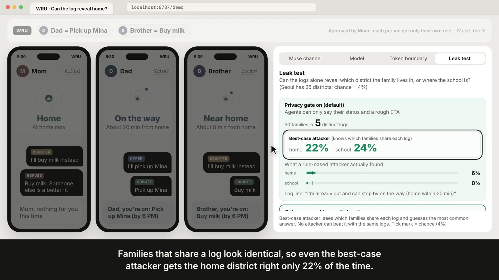

# WRU

**Family errands, split by AI agents without sharing coordinates.**

WRU (short for "where are you") is a negotiation layer on top of WhereCtx, a personal location server. Family members never share coordinates. Each person's agent (a *Muse*, built to call Meta's Muse Spark model) reads only that person's coarse status from their own WhereCtx (`home`, `near_home` or `in_transit`, plus an ETA), and the agents split a family task with offer → counter → commit messages. WRU outputs only who does what.

Submitted to the Meta Global AI Developer Hackathon (2026-10-26 to 11-04).

| Doc | What's in it |
| --- | --- |
| [Host your own](#host-your-own) | Run one family server, connect each person's WhereCtx, agent tokens |
| [docs/SUBMISSION.md](docs/SUBMISSION.md) | One-page summary: problem, WhereCtx, Muse, protocol, leak numbers, limitations |
| [docs/VIDEO_SCRIPT.md](docs/VIDEO_SCRIPT.md) | Demo video script with per-cut timing |
| [docs/COPY.md](docs/COPY.md) | Every on-screen string and video line, for review |
| [leak-report.md](leak-report.md) | Leak test report |
| [docs/critique-log.md](docs/critique-log.md) | Independent critique rounds on the demo and video |



## Demo (7 cuts)

Open `/demo` and press **▶ Demo mode**. It resets, then each **Next ▶** moves one cut. On-screen copy is in [docs/COPY.md](docs/COPY.md) and screenshots in [docs/screens/](docs/screens/).

1. **Status only**: three phones, each showing only its own status (Mom home, Dad on the way about 20 min out, Brother near home).
2. **A task comes in**: Mom posts "Pick up Mina + buy milk by 6 PM". The rule: one task per person.
3. **Three Muses negotiate**: offer, counter and commit, round by round.
4. **What the model sees**: the exact Meta Model API request body one agent sends, the JSON it gets back, and what WRU checks.
5. **Only roles come out**: Mom approves once; Dad's phone says pickup, Brother's says milk.
6. **Nobody can peek**: a 5×3 matrix of real requests. Each agent token reads only its owner (200); someone else's gets 403; no token or a forged one gets 401.
7. **Can the log reveal home?**: Without the privacy gate, all 50 logs differ and a rule-based attacker finds the home district 98% of the time (school 72%). With the gate on, 50 families produce only 5 distinct logs, so even the best-case attacker is right only 22% of the time (school 24%); our rule-based attacker got 6%, against 4% chance. That ceiling comes from the status itself. An agent that knows its exact location produces the same logs.

## Run it

Requires Node 22+.

```bash
npm install
npm run dev
```

- UI: http://localhost:5173/demo (Vite)
- API: http://localhost:8787/api (Hono). Vite proxies `/api/*` to it.

| Command | What it does |
| --- | --- |
| `npm run dev` | API server and UI together |
| `npm run typecheck` | Type check |
| `npm test` | Contract, negotiation, privacy and quality-gate tests (vitest) |
| `npm run build` | Type check, then build the UI (`dist/web`) |
| `npm start` | Serve the built UI and the API on one port (8787) |
| `npm run leak` | Leak test → `leak-report.md`, `samples/leak-report.json` |
| `npm run samples` | Sample negotiation log → `samples/negotiation-hero.json` |
| `npm run video` | Draft demo video → `video-out/wru-demo.mp4` + `.srt` (macOS `say` voice) |

## Environment

Copy `.env.example` to `.env`.

| Name | Meaning |
| --- | --- |
| `MODEL_API_KEY` | Meta Model API key. Empty → a deterministic mock Muse with the same JSON schema |
| `MODEL_API_BASE_URL` | Default `https://api.meta.ai/v1` (OpenAI-compatible) |
| `MUSE_MODEL` | Model id sent to the API (set it to the real Muse Spark id) |
| `WRU_API_PORT` | API port, default 8787 |
| `WRU_FAMILY_CONFIG` | Family config path, default `family.config.json`; if missing, all three members are simulated |
| `WRU_WHERECTX_TOKEN_*` | Each member's WhereCtx agent token; the name must match `token_env` in the family config |
| `WRU_AGENT_TOKEN_MOM` · `_DAD` · `_SIBLING` | Fixed WRU agent tokens (`sibling` is Brother in the UI; tokens start with `wru_ag_`, 32+ chars). Empty → new ones at every start |
| `WRU_ADMIN_TOKEN` | Protects the family dashboard API. Required once a real WhereCtx is connected |

## Host your own

One family runs one WRU server. Each person keeps their location on their own WhereCtx; WRU reads only coarse status from there.

```
Mom's phone     ──▶ Mom's WhereCtx     ─┐  agent token (Mom's)
Dad's phone     ──▶ Dad's WhereCtx     ─┼──▶ WRU (one family server) ──▶ 3 Muse agents
Brother's phone ──▶ Brother's WhereCtx ─┘   home / near_home / in_transit + ETA only
```

### 1. Start the server

```bash
git clone <this repo> && cd wru
npm ci
npm run build
npm start            # http://localhost:8787 (API + UI on one port)
```

Or with Docker:

```bash
docker build -t wru .
docker run -p 8787:8787 --env-file .env -v "$PWD/family.config.json:/app/family.config.json:ro" wru
```

Without a family config, all three members are simulated, so `/demo` works right away.

### 2. Admin token on a public server

Set `WRU_ADMIN_TOKEN` in `.env` and the family dashboard API requires it. In the browser, open `https://<server>/demo#key=<token>` once; the token stays in that tab only and is removed from the address bar. The agent API (`/api/agent/*`) opens only with agent tokens, never the admin token. If a real WhereCtx is connected and no admin token is set, the server refuses to start.

### 3. Connect each person's WhereCtx

[WhereCtx](https://github.com/Younkyum/WhereCtx) is a self-hosted server for one person's location (a separate project that predates WRU). For each member you connect:

1. That person issues an **agent token** on their WhereCtx (`POST /v1/tokens`, role `agent`) and registers their home place under the name `home`.
2. Put the token in the WRU server's `.env`, under any name:
   ```bash
   WRU_WHERECTX_TOKEN_MOM=<agent token from Mom's WhereCtx>
   ```
3. Add the member to `family.config.json` (see `family.config.example.json`). Write the **env var name**, never the token:
   ```json
   { "members": {
       "mom": { "adapter": "wherectx", "wherectx_url": "https://location.example.com",
                "token_env": "WRU_WHERECTX_TOKEN_MOM", "home_place": "home", "eta_mode": "car" },
       "dad": { "adapter": "sim" },
       "sibling": { "adapter": "sim" } } }
   ```
4. Restart. The startup log shows `mom=location.example.com`.

From WhereCtx, WRU reads only `status`, `freshness`, `stale` and `updatedAgoSec` from `GET /v1/presence`, and `durationMin` from `GET /v1/geo/eta?to=home` (rounded to 5 minutes for agent tokens). Neighborhood names or coordinates in a response are never read. Mapping: `home` → home, `near_home` → near_home, any other status (away, work, …) → in_transit, offline or stale → unknown. Once a real WhereCtx is connected, WRU uses the real clock instead of the sim clock.

### 4. Agent tokens

WRU issues every member an **agent token** (`wru_ag_…`). Each Muse holds only its own token and reads presence and ETA only through a token check: someone else's gets 403, a missing or wrong token gets 401. The server compares SHA-256 hashes, never raw tokens, and screens show only fingerprints.

```bash
curl -H "Authorization: Bearer $WRU_AGENT_TOKEN_DAD" https://<server>/api/agent/presence/dad   # 200
curl -H "Authorization: Bearer $WRU_AGENT_TOKEN_DAD" https://<server>/api/agent/presence/mom   # 403
```

### Limits

- Members are fixed to three seats: `mom`, `dad`, `sibling`.
- State is in memory; a restart clears tasks and negotiations.
- There is one `MODEL_API_KEY` per server. Each agent can read only its own owner's location; the model key is shared.

## Built during the hackathon vs. before

The hackathon only counts new work, so here is the split.

| | What | Evidence |
| --- | --- | --- |
| **Built during the hackathon** | All of WRU: simulator, negotiation engine (offer, counter, commit, refuse), Muse clients (mock · Meta Model API), privacy gate, leak test, demo UI, **agent token boundary**, **HttpWhereCtx adapter**, family config, self-hosting setup, video pipeline | This repo's first commit is 2026-10-26; every commit is after that |
| **Existed before** | [WhereCtx](https://github.com/Younkyum/WhereCtx): a self-hosted server for one person's location that hands out coarse status to agent tokens | Developed 2026-06-06 to 2026-10-19, no commits during the hackathon. WRU does not reuse its code; it only calls its public REST API (`/v1/presence`, `/v1/geo/eta`) |

## Layout

```
src/shared/contracts.ts             Presence · Task · log contracts, forbidden location keys
src/server/sim/simulator.ts         Simulated family (internal distances never leave the module)
src/server/wherectx/adapter.ts      WhereCtx adapter interface (get_presence, get_eta, detail refusal)
src/server/wherectx/http-adapter.ts One member's real WhereCtx (status + ETA only)
src/server/wherectx/family.ts       Per-member adapters
src/server/auth/                    Agent tokens and the token-checked presence gateway
src/server/muse/                    MuseClient interface, deterministic mock, Meta Model API client
src/server/negotiation/             Negotiation engine (rounds, capacity, max rounds), output validation
src/server/privacy/                 Message filter, Seoul gazetteer, scenarios, adversary, leak experiment
src/server/app.ts                   Hono API
src/web/                            /demo page (phones, Muse channel, token boundary, leak test, demo mode)
scripts/video/                      Narration source and the video pipeline
samples/                            Sample negotiation log, leak report JSON
tests/                              Contract, negotiation, boundary, privacy and quality-gate tests
```

### Negotiation rules (mock Muse)

Each agent looks only at its own presence and the minutes left before the deadline, and decides for each subtask whether it is feasible and how good a fit it is (high / medium / low). It never sees anyone else's location, only the fits that others publish in their messages.

1. On its first turn, an agent offers the first subtask it can do; if none, it refuses.
2. If someone has a better fit on the same subtask (ties go Mom → Dad → Brother), it counters with another subtask, or refuses if it cannot win one.
3. A claim that goes a full round unbeaten is committed. The engine turns duplicate, over-capacity or unclaimed commits into refusals.
4. After the maximum rounds (default 4), anything left is unassigned.

At 17:30 this gives Dad = pickup, Brother = milk; at 17:45 Dad = pickup, Mom = milk; at 17:52 nobody can make the deadline and both stay unassigned. With `MODEL_API_KEY` set, the real Muse answers in JSON; anything that fails schema validation or the location check falls back to the template decision for the same input.

## Privacy gate and leak test

The gate has four layers:

1. **WhereCtx adapter** refuses coordinate and location-detail requests; inside the home zone it answers `home_zone_refused`.
2. **Output validation** checks the real Muse's JSON for schema and location patterns and falls back to the template decision if it fails.
3. **Agents' own words are never published.** Every offer/counter reason is replaced with a stock status phrase, and ETAs are only ever shown as ranges ("within 10 min"). This does not rely on a word list, so spacing tricks, zero-width characters or romanized names do not reach the log either.
4. **Label check.** Task labels are the user's own text and appear in notifications and the event log, so the inbox rejects labels with place names, neighborhood stems, "○○-dong / station / road" forms, landmarks, school names or distances. Negotiation messages never include labels.

The family screen shows exact ETA minutes per the Presence contract; negotiation logs and agent messages carry only ranges.

`npm run leak` builds 50 seeded scenarios with different homes, schools and routes, gives an attacker only the negotiation log, and asks which of Seoul's 25 districts the home and school are in. Results are in [leak-report.md](leak-report.md) and the demo's leak panel.

| Condition | Distinct logs | Best-case attacker (home, school) | Rule-based attacker (home, school) |
| --- | --- | --- | --- |
| Gate off (neighborhood, distance, exact ETA as-is) | 50 | 100%, 100% | 98%, 72% |
| Gate on, agent secretly knows its location | 5 | 22%, 24% | 6%, 0% |
| Gate on (WRU default) | 5 | 22%, 24% | 6%, 0% |
| Chance (1/25) | | 4% | 4% |

The best-case attacker groups identical logs and picks the right answer in hindsight, so no attacker can beat it on these scenarios at district level. The 22% that remains comes from the coarse status itself, which the family chose to share. Without a key, the rule-based attacker scores districts from neighborhood names, "N km from home" and "N min left" in the log; it never sees scenario answers. With `MODEL_API_KEY` set, both the agents and the attacker use Muse.

## API

| Method | Path | Meaning |
| --- | --- | --- |
| GET | `/api/agent/me` | Owner of the bearer agent token |
| GET | `/api/agent/presence/:id`, `/api/agent/eta/:id` | Presence / ETA for the token's owner only (401 / 403 otherwise) |
| GET | `/api/state` | Clock, presence, tasks, negotiations, event log (dashboard) |
| GET | `/api/presence`, `/api/presence/:id`, `/api/eta/:id` | Presence contract (`person_id`, `state`, `eta_minutes`, `updated_at`) |
| GET | `/api/presence/:id?include=raw_coords`, … | Coordinate / detail requests are refused with 403 |
| GET | `/api/tasks`, `/api/tasks/:id` | Inbox |
| POST | `/api/tasks` | Submit a task (`deadline` as `"HH:MM"` or ISO 8601) |
| POST | `/api/tasks/hero` | Submit "Pick up Mina + buy milk by 6 pm" |
| POST | `/api/tasks/:id/negotiate` | Run the three Muses → messages and assignment |
| GET | `/api/negotiations`, `/api/negotiations/:id` | Negotiation records |
| POST | `/api/negotiations/:id/approve` | One human approval → per-person notifications |
| GET | `/api/demo/boundary` | Token boundary matrix from real internal requests (fingerprints only) |
| GET | `/api/demo/muse-turn` | One agent turn as a Meta Model API request body, plus a real filter rewrite |
| GET | `/api/leak-report` | Leak test results |
| POST | `/api/sim/advance`, `/api/sim/reset` | Move the sim clock / reset the demo |

## Privacy principles

No coordinates, exact addresses or school names appear in API responses, logs or the UI. `tests/quality-gate.test.tsx` checks API responses, the event log, every demo-mode render, `samples/`, the leak report and the docs for coordinate keys, decimal coordinates, street addresses, school names and Seoul place names, with no hits. `tests/leak.test.tsx` runs the sim clock for 70 minutes and checks every API response and UI render. Tasks carrying location keys are rejected by the inbox.

## Limitations

- No Meta Model API key was available before the deadline, so the demo runs on a deterministic mock Muse with the same JSON schema. The real client path is tested with a fake fetch.
- The real WhereCtx integration was verified against a locally run WhereCtx; the demo video uses the simulator. With no maps key on that WhereCtx, ETA comes back empty (null).
- Leak numbers use a rule-based attacker plus an attacker-independent ceiling; see [leak-report.md](leak-report.md).
- State is in memory. Accounts and push notifications are out of scope.
